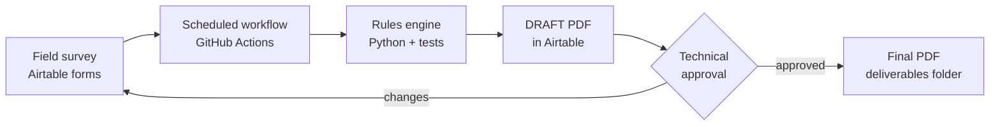

# Backup-power quotation engine with business rules and human approval

[Español](README-es.md) · [Inicio / Home](../README.md)

**Tools:** Python · Airtable (forms and API) · GitHub Actions · Playwright (PDF) · Google Drive · AI-assisted development (Claude Code).
**Context:** applied project at Aponwaonet, October–November 2026. The code and commercial rules belong to Aponwaonet and are not published.
**Status:** supervised internal pilot. Before version 1.0: grounding requirements, confirming provisional rules and updating supplier price lists.

## Challenge
Quotes for backup systems (inverter plus batteries) were built case by case. Load studies frequently contained errors: devices counted twice, nameplate ratings treated as continuous consumption, 50 Hz data used on a 60 Hz grid. Each proposal depended on who calculated it, and slow responses let leads go cold.

The earlier n8n and Gemini prototype ([case 02](../02-n8n-quotations-ai/README-en.md)) showed that a language model alone did not produce consistent quotations.

## Approach
Move from "quoting blind" to a structured process:

1. **Explicit business rules.** Design duration, depth of discharge, inverter factor, motor starting, margins and payment terms, each with a status (decided, provisional or pending) and a source.
2. **An engine that verifies rather than decides.** A person proposes the equipment. The engine checks power, starting surges, energy, battery currents and recharge time, and raises alerts traceable to each rule. It never invents values: missing data is reported.
3. **Mandatory human approval.** Every quotation is a draft until the technical approver signs off.
4. **Field capture without a computer.** Airtable forms feed a GitHub Actions workflow that generates the PDF and attaches it to the record.

## My contribution
- **Product and process:** defined the problem, field workflow, quotation states and approval rule. Coordinated decisions with the technical approver and recorded them in a dated rules log with sources.
- **Data:**
  - cleaned real load studies (duplicates, units, nameplate data versus energy labels);
  - checked datasheets against supplier price lists;
  - separated verified data from estimates.
- **Commercial analysis:** packages for a residential area of about 3,700 apartments, with price ranges and autonomy and recharge scenarios.
- **Privacy:** kept customer data (Airtable and private Drive) apart from the code (private repository). Credentials are stored as GitHub secrets, never in code.
- **AI-assisted development:** the code was written by Claude Code under my direction. I defined requirements, rules and acceptance criteria, and validated results against real cases.

## Deliverables
- **Quotation engine** with 55 automated tests and a register of 28 rules: 21 decided, 6 provisional and 1 pending.
- **Branded PDF quotation** with autonomy options, terms and usage recommendations.
- **Airtable field workflow:**
  - wattage computed from volts × amps when a device has no wattage plate;
  - annual energy labels used for refrigerators;
  - site coordinates;
  - automatic blocking when safety data is missing.
- **Documentation** of decisions, open items and project continuity.

## Results and scope
- Tested end to end (form → automated workflow → PDF in Airtable) with a test record.
- Real cases loaded in Airtable for reference: 3 customers, 1 still preliminary.
- Two area-wide offers approved by the technical approver and used as the basis for promotional material.
- **Impact example from a real case:** using the refrigerator's energy label instead of its nameplate rating reduced the required batteries from 2 units to 1 for the same 4 hours.
- **Not yet measured:** response time and sales attributable to the tool. The system has not reached version 1.0.

## Lessons
- A language model is useful for reading and organizing (for example, nameplate photos). Calculations and pricing need verifiable rules and human approval.
- Input data is the biggest risk: most corrections came from the load study, not from the calculation.
- Field constraints (no budget for paid APIs, mobile app limits, buildings without grounding) shaped the design as much as the technical work.

## Evidence
The code, commercial rules, prices and quotations are kept privately at Aponwaonet. This case contains no customer data. The [structure example](../06-cotizacion-ejemplo.json) is fictional.
