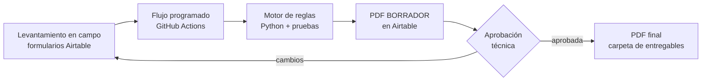

# Cotizador de respaldo eléctrico con reglas de negocio y aprobación humana

[English](README-en.md) · [Inicio / Home](../README.md)

**Herramientas:** Python · Airtable (formularios y API) · GitHub Actions · Playwright (PDF) · Google Drive · desarrollo asistido por IA (Claude Code).
**Contexto:** proyecto aplicado en Aponwaonet, octubre–noviembre de 2026. El código y las reglas comerciales pertenecen a Aponwaonet y no se publican.
**Estado:** piloto de uso interno con supervisión. Pendientes antes de la versión 1.0: la puesta a tierra, confirmar reglas provisionales y actualizar las listas de precios.

## Reto
Las cotizaciones de sistemas de respaldo (inversor más baterías) se armaban caso por caso. Las cargas venían de estudios con errores frecuentes: equipos contados dos veces, consumos de placa tomados como consumo continuo, datos de 50 Hz usados en una red de 60 Hz. Cada propuesta dependía de quien la calculaba, y el tiempo de respuesta enfriaba al cliente potencial.

El prototipo anterior con n8n y Gemini ([caso 02](../02-n8n-quotations-ai/README-es.md)) mostró que un modelo de lenguaje por sí solo no producía cotizaciones consistentes.

## Enfoque
Pasar de "cotizar a ciegas" a un proceso con estructura:

1. **Reglas de negocio explícitas.** Duración de diseño, profundidad de descarga, factor del inversor, arranque de motores, márgenes y condiciones de pago, cada una con su estado (decidida, provisional o pendiente) y con su fuente.
2. **Un motor que verifica, no que decide.** La persona propone el equipo. El motor comprueba potencia, arranques, energía, corrientes de batería y tiempo de recarga, y emite alertas trazables a cada regla. No inventa valores: si falta un dato, lo dice.
3. **Aprobación humana obligatoria.** Toda cotización sale como borrador hasta que el aprobador técnico la firma.
4. **Captura en campo sin computadora.** Formularios de Airtable alimentan un flujo de GitHub Actions que genera el PDF y lo devuelve al registro.

## Mi aporte
- **Producto y proceso:** definí el problema, el flujo de campo, los estados de la cotización y la regla de aprobación. Coordiné las decisiones con el aprobador técnico y las registré en una bitácora de reglas con fecha y fuente.
- **Datos:**
  - depuré estudios de carga reales: duplicados, unidades, datos de placa frente a etiquetas de consumo;
  - contrasté fichas técnicas con las listas de precios del proveedor;
  - separé los datos verificados de los estimados.
- **Análisis comercial:** paquetes para una zona residencial de unos 3.700 apartamentos, con rangos de precio y escenarios de autonomía y recarga.
- **Privacidad:** separé los datos de clientes (Airtable y Drive privado) del código (repositorio privado). Los secretos se guardan como secretos de GitHub, nunca en el código.
- **Desarrollo asistido por IA:** el código lo escribió Claude Code bajo mi dirección. Yo definí requisitos, reglas y criterios de aceptación, y validé los resultados contra casos reales.

## Entregables
- **Motor de cotización** con 55 pruebas automáticas, y un registro de 28 reglas: 21 decididas, 6 provisionales y 1 pendiente.
- **Cotización en PDF** con la marca de la empresa, opciones de autonomía, condiciones y recomendaciones de uso.
- **Flujo de campo en Airtable:**
  - cálculo de vatios por voltios × amperios cuando el equipo no trae placa;
  - uso de la etiqueta de consumo anual en neveras;
  - coordenadas del sitio;
  - bloqueo automático cuando falta un dato de seguridad.
- **Documentación de decisiones, pendientes y continuidad** del proyecto.

## Resultados y alcance
- Probado de punta a punta (formulario → flujo automático → PDF en Airtable) con un registro de prueba.
- Casos reales cargados en Airtable para consulta: 3 clientes, 1 de ellos todavía preliminar.
- Dos ofertas de zona aprobadas por el aprobador técnico y usadas como base de material publicitario.
- **Ejemplo de impacto en un caso real:** con la etiqueta de consumo de la nevera en lugar del consumo de placa, la batería necesaria bajó de 2 unidades a 1 para las mismas 4 horas.
- **No se miden todavía** el tiempo de respuesta ni las ventas atribuibles al cotizador. El sistema no ha cerrado su versión 1.0.

## Aprendizajes
- Un modelo de lenguaje sirve para leer y organizar (por ejemplo, fotos de placas). El cálculo y el precio necesitan reglas verificables y una persona que apruebe.
- Los datos de entrada son el mayor riesgo: la mayoría de las correcciones vinieron del estudio de carga, no del cálculo.
- Las restricciones de campo (sin presupuesto para APIs pagas, límites de la app móvil, edificios sin puesta a tierra) definieron el diseño tanto como la parte técnica.

## Evidencia
El código, las reglas comerciales, los precios y las cotizaciones se conservan de forma privada en Aponwaonet. Este caso no incluye datos de clientes. El [ejemplo de estructura](../06-cotizacion-ejemplo.json) es ficticio.
